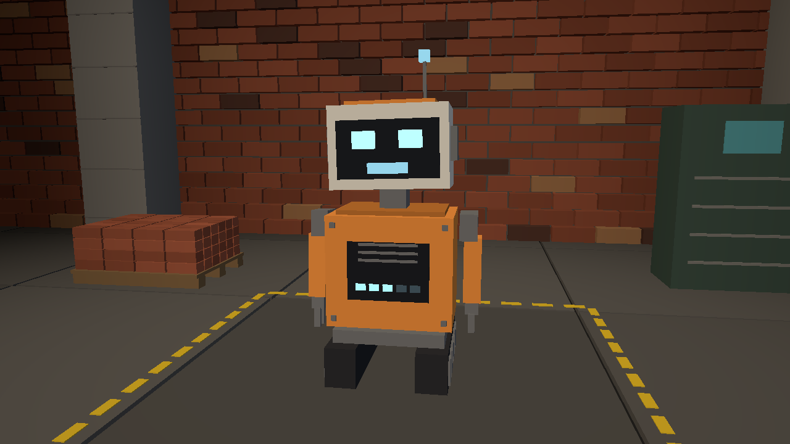

# Delta

[Français](README.fr.md)

Delta is a small robot you talk to with your voice, in English or in French. It stands in a brick hall drawn with Vulkan, listens on
your microphone, and speaks with a local voice. It works two ways:

- **As Claude Code's voice.** Delta hears you and passes what you say to your Claude Code session. Claude does the work
  and answers through Delta.
- **On its own.** It answers with a language model running on your machine, and nothing leaves your computer. It can
  only talk: it cannot build, run or change anything, and it says so.



Delta is the first step of Brickyard, a software factory you drive by voice
([GuitarAlchemist/gaia#259](https://github.com/GuitarAlchemist/gaia/issues/259)).

## With Claude Code

You need Windows 10 or 11, x64, with a GPU whose driver supports Vulkan 1.3, a microphone, and
[Claude Code](https://code.claude.com/docs/en/overview). Headphones keep Delta's voice out of the microphone.

1. Install the plugin. In Claude Code, run:

   ```
   /plugin marketplace add GuitarAlchemist/brickyard
   /plugin install delta@brickyard
   ```

   Since Claude Code 2.1.275, `/plugin install delta --marketplace GuitarAlchemist/brickyard` does both in one step.
2. Run `/delta:setup`. Claude asks which language Delta should hear and speak, English (the default) or French, checks
   what is already there, tells you what it would download, and asks first.
   - The first time, that is about 700 MB: Delta, Piper and a voice for that language, whisper.cpp, and a Whisper
     model.
   - To change the language later, run `/delta:setup` again and ask for the other one.
   - If you already have Piper, whisper.cpp or the model, give Claude their paths instead.
   - Each download is checked against its SHA-256.
3. Talk to Delta, in either of two ways:
   - **Your voice comes in by itself.** Restart Claude Code with Delta's
     [channel](https://code.claude.com/docs/en/channels), then start a sentence with "Delta":

     ```
     claude --dangerously-load-development-channels plugin:delta@brickyard
     ```

     Channels are a research preview, so Claude Code asks you to confirm the flag. On Team and Enterprise plans, an
     admin must allow channels first.
   - **Any session, without the flag.** Run `/delta:talk`. Claude then listens and answers in turns until you say
     "goodbye" (« au revoir » in French).

Delta's window opens when Claude Code starts the plugin's MCP server.

Which speech Delta passes on:
- **Through the channel**:
  - sentences that start by calling it, "Delta, …", or its brain, "Claude, …";
  - the next sentences within 15 seconds;
  - your answer within 20 seconds of its last words.

  It drops a sentence that says "I'm not talking to you" or « je ne te parle pas », or that calls one of the author's
  other sessions first: Brutal, Gaïa, Indigo, Amber, Codex or IX. That also ends the conversation.
- **With `/delta:talk`**, everything Delta hears while Claude listens.

Claude Code asks your permission the first time Claude uses Delta's `say` and `listen` tools.

Delta does some things itself, without Claude, when a short sentence asks for them. It understands them in English
and in French whatever its language, and answers in its own:
- **Its window.** "Delta, move to the top left", "go to the right", "go to the center", "maximize your window",
  "minimize", "full screen", "restore your window", "make yourself smaller", "stay on top". "Hide" puts it in the
  notification area, by the clock; "Delta, come back" or a click on its icon brings it back. In French: « mets-toi en
  haut à gauche », « maximise ta fenêtre », « cache-toi », « reviens ».
- **Its shelf**, a small menu in its window. "Delta, show me the sessions" lists this computer's Claude Code
  sessions, grouped by wmux workspace, those waiting for you first. "Show the conversations" lists the past ones by
  project, the most recent first, each opening onto its last requests. "Show the plugins" and "show the marketplaces"
  list what is installed. While the shelf is open, "go down", "go up", "open" and "back" move through it, without
  "Delta" within 20 seconds of the last step, and "close the menu" closes it. In French: « montre-moi les sessions »,
  « montre les conversations », « descends », « monte », « ouvre », « retour », « ferme le menu ». Tab or M opens it
  with the keyboard too, then the arrows, Enter, Backspace and Esc; the mouse and its wheel work as well. In a session
  that runs in wmux, "Go to this session" shows its pane. The shelf's labels follow Delta's language.

What you say is transcribed on your machine. The text then goes to Claude like anything you type.

## On its own

### What you need

- Windows 10 or 11, x64, with a GPU whose driver supports Vulkan 1.3.
- A microphone and speakers or headphones. Delta does not listen while it speaks, but headphones keep its voice out of
  the microphone.
- About 6 GB of free video memory (or memory) for the language model.

Delta does not ship the four programs below. Each is free and has its own licence. Put them next to `start-delta.ps1`,
or give their paths to it.

| What | Where to get it | Where it goes |
|---|---|---|
| Ollama and the model | [ollama.com](https://ollama.com), then `ollama pull qwen3:8b` | Ollama's own install |
| Piper, the voice engine | `piper_windows_amd64.zip` from [rhasspy/piper 2023.11.14-2](https://github.com/rhasspy/piper/releases/tag/2023.11.14-2) | unzipped here, so that `piper\piper.exe` exists |
| A Piper voice | English: `en_US-ljspeech-medium.onnx` and its `.onnx.json` from [rhasspy/piper-voices](https://huggingface.co/rhasspy/piper-voices/tree/main/en/en_US/ljspeech/medium). French: `fr_FR-siwis-medium.onnx` and its `.onnx.json` from [rhasspy/piper-voices](https://huggingface.co/rhasspy/piper-voices/tree/main/fr/fr_FR/siwis/medium) | `voices\` |
| whisper.cpp's server, which transcribes | `whisper-blas-bin-x64.zip` from [whisper.cpp b5454](https://github.com/ggml-org/whisper.cpp/releases/tag/b5454) | `whisper\`, so that `whisper\whisper-server.exe` exists (the zip puts it in a `Release` folder: move its files up) |
| A Whisper model | `ggml-large-v3-turbo-q5_0.bin` from [ggerganov/whisper.cpp](https://huggingface.co/ggerganov/whisper.cpp/blob/main/ggml-large-v3-turbo-q5_0.bin) | `whisper\` |

The versions Delta was tested with have these SHA-256 hashes: `whisper-blas-bin-x64.zip`
`b1158bd10edf92c9799149a6fc5d3e58da3f495241d6fb3423088130e88ffbf3`, `ggml-large-v3-turbo-q5_0.bin`
`394221709cd5ad1f40c46e6031ca61bce88931e6e088c188294c6d5a55ffa7e2`.

Any Piper voice in Delta's language works. Read its model card before using it in public. ljspeech's gives its
dataset, LJ Speech, as public domain. siwis's gives its dataset's licence as CC BY 4.0, and says the voice was
fine-tuned from the English lessac voice.

### Start

Unzip `delta-<version>-win-x64.zip` from the [latest release](https://github.com/GuitarAlchemist/brickyard/releases/latest), add the programs above, then run this in PowerShell, in that folder:

```powershell
Get-ChildItem -Recurse | Unblock-File   # once: Windows marks files downloaded from the internet
.\start-delta.ps1
```

If PowerShell refuses to run scripts, use `powershell -ExecutionPolicy Bypass -File .\start-delta.ps1`.

The script checks every prerequisite first and says what is missing. The window opens on BRUTAL's logo for about
2.5 seconds, then shows Delta. The first answer takes longer, while the model loads. Speak to it: its eyes turn green
while it hears you, amber while it thinks, and its mouth follows its voice. Press Ctrl+C in the terminal to stop.

| Option | What it does |
|---|---|
| `-Type` | Type your sentences instead of speaking; whisper.cpp is not needed then |
| `-Lang fr` | Hear and speak French, with the French voice; English is the default |
| `-Voice <file.onnx>` | Another Piper voice, in Delta's language |
| `-Model <name>` | Another Ollama model (default `qwen3:8b`) |
| `-Piper`, `-Whisper`, `-WhisperModel` | Paths, if the programs are elsewhere |
| `-Ollama <url>` | Ollama's address (default `http://127.0.0.1:11434`) |

## How it works

- `brain\` is in Go, using only the standard library. It listens on the default microphone (16 kHz). An energy
  threshold cuts what you say into sentences, and whisper.cpp's server transcribes them on 127.0.0.1:8806. The text
  goes to Ollama. The answer is cut into sentences as it streams, and each sentence goes to Piper and is played as
  soon as it is ready.
- `scene\` is in C# and draws with Vulkan through [BRUTAL](https://github.com/ahwootech/BRUTAL). The brain tells it what Delta
  is doing with one JSON line per change on 127.0.0.1:8805. The line can be `{"state":"idle"}`, `"listening"` or
  `"thinking"`, or `{"state":"speaking","seconds":S,"envelope":[...]}` with the voice's loudness every 20 ms. A line
  can also carry `"context":{"used":tokens,"limit":tokens}`, `"compacting":true` or `false`, `"mood"` (an
  expression), `"window"` (a move of the window) and `"shelf"` (a move through the shelf).

The brain starts whisper.cpp's server itself and stops it when it exits.

With Claude Code, `brain.exe -mcp` is an MCP server on stdio, which the plugin's manifest starts
([plugins/delta](plugins/delta)).
- It gives Claude four tools. `say` speaks a text and returns at once; its `mood`, such as `joy`, `proud` or
  `sorry`, is the expression Delta's face takes as it starts. `listen` waits for the next sentence. `window` moves,
  sizes or hides Delta's window, and `shelf` walks its menu.
- It declares a Claude Code channel. A sentence that no `listen` is waiting for is pushed into the session as a
  channel event, if it starts with "Delta" or "Claude" or comes soon after Delta spoke.
- With `-triage <model>`, or `"triage"` in `delta.json`, a small Ollama model sorts those sentences first. It answers
  greetings and thanks itself at no cost, drops what is meant for someone else, and passes the rest to Claude.
  Questions, sentences that start with "Claude", and answers to Claude's own questions always go to Claude. A lamp on
  Delta's chest is green while the small model answers and gold while Claude does, with a star beside its head.
- With `-journal <file>`, it writes one JSON line per sentence heard, with its route and the triage's verdict, and
  per sentence said.
- One Delta runs at a time on the machine: a newer brain records itself in `%LOCALAPPDATA%\delta\brain.pid`, and the
  older one tells its session, then stops.
- The Mac minis Delta's torso is stacked from show how full Claude's context is: their lights fill layer by layer up
  to the top, where Claude Code compacts the conversation, pale blue, then amber, then red. The brain reads it from the
  session's transcript every few seconds. While Claude Code compacts, the stack is pressed down, a violet light runs
  down it, and Delta tells whoever speaks to Claude meanwhile that the answer will be late. The plugin's hooks
  ([plugins/delta/hooks/hooks.json](plugins/delta/hooks/hooks.json)) post the start and the end of a compaction to the
  brain on 127.0.0.1:8807 (`-hooks`).
- When a sentence goes to Claude, Delta says a short word at once, « Une seconde. » or "Let me check.", so that the
  first sound comes in under a second while Claude thinks. It says nothing while it is already speaking, and drops the
  word if Claude's answer is ready first. The journal's `heard` line gives its `ack`, the `say_id` of a `say` line by
  `ack`.
- Delta's face has eyebrows and mouth corners besides its eyes: neutral, joy, surprise, doubt, sorry, proud, wink,
  focus and sleepy. An expression lasts six seconds. Small talk that Delta answers itself makes it smile, « bonne
  nuit » makes it sleepy, and it dozes off after four minutes of quiet. "Delta, I love you" or « je t'aime » sends
  red hearts rising from its chest while it smiles.
- Delta speaks with IX's warm voice: the same Piper voice through an equaliser, a gentle compressor, a touch of
  saturation and a small room (`brain\fx.go`). `-fx none` gives Piper's own voice.
- A camera process can post hand gestures to the same address, `POST /gesture` with the same header:
  `{"gesture":"thumbs_up","hand":"right","confidence":0.92,"t_ms":...}`. A thumb up makes Delta smile and a thumb
  down look sorry; a wave opens the conversation, so that the next sentence needs no « Delta »; pointing up or down
  and swiping left or right walk the shelf while it is open. `open_palm` and `fist` are only recorded. Each gesture
  is a `gesture` line in the journal. No camera process ships yet.
- Another device can talk to Delta through a gateway on this computer, such as IX's over WebRTC. The gateway posts
  each sentence the device heard, a 16 kHz mono WAV of at most 30 s, to `POST /hear` on the same address, and plays
  what Delta says from `GET /said`, one server-sent event per sentence with its WAV. Both need the hooks' header and
  `X-Delta-Remote`, the secret the brain writes at each start to `%LOCALAPPDATA%\delta\remote.secret`. A sentence from
  another device needs no « Delta », and the triage may answer it but not drop it; a chime tells the room, and Claude
  has the user confirm at the computer anything destructive it asks for. The whole address refuses a request with an `Origin` header, or for another host than
  127.0.0.1, localhost or ::1.
- whisper.cpp's server then runs on a free port. With `"whisper_fallback"` in `delta.json`, such as the CPU build
  behind a GPU build in `"whisper"`, the brain runs the fallback when the first cannot start or hear, or dies. The
  journal's `ears` line says which one hears, and why the other does not.

The marketplace is [.claude-plugin/marketplace.json](.claude-plugin/marketplace.json). A tag `v<version>` builds the
release with [.github/workflows/release.yml](.github/workflows/release.yml). `/delta:setup` installs that release, for
the plugin's version.

## Build from source

You need the .NET 10 SDK and Go. `.\check-plugin.ps1` checks the plugin and the marketplace. `.\release.ps1` builds both parts and packs `dist\delta-<version>-win-x64.zip`. You
can also build each part on its own: `go build` in `brain\`, and `dotnet build -c Release` in `scene\`. The scene
needs no brain to run:

- `scene.exe --demo` plays the four states;
- `--shots DIR` with `--demo` saves a PNG of each;
- `--selftest` checks the protocol without a window.

`git config core.hooksPath .githooks` runs CI's checks, for the parts a commit touches, before each commit.
`.\dev-deploy.ps1 -PluginData <dir> -McpJson <.mcp.json>` builds the checkout beside the installed Delta and points
Claude Code at it, to try a change live. With Ollama running, `DELTA_TRIAGE_OLLAMA=http://127.0.0.1:11434 go test -run
TriageCorpus -v` in `brain\` sorts sentences heard live (`brain\testdata\triage-corpus.json`) with the real model.

## Licences and credits

Delta's own code is under the [MIT licence](LICENSE).

The scene is built with BRUTAL:

> BRUTAL game development framework is Copyright (c) 2024 Ahwoo Limited.
>
> This product is built with BRUTAL, a game development framework by Ahwoo Limited, used under the BRUTAL License
> v1.0.
>
> www.ahwoo.com/brutal

BRUTAL's licence ([LICENSES/BRUTAL/LICENSE.txt](LICENSES/BRUTAL/LICENSE.txt)) asks three things of a distributed
product, and Delta does each:

| The licence asks | Delta does |
|---|---|
| The Brutal logo before the product starts | The scene opens on it. The logo is Ahwoo's, from [ahwootech/brutal-branding](https://github.com/ahwootech/brutal-branding/tree/5d38373a24fed6f8afcc8bc803c96b6163ddf4b4), unaltered except for scaling |
| BRUTAL's copyright in the credits | The notice is shown under the logo, and quoted here |
| `NOTICE.txt` alongside the product | It is in the release |

[THIRD_PARTY.md](THIRD_PARTY.md) lists the other components and their licences.
